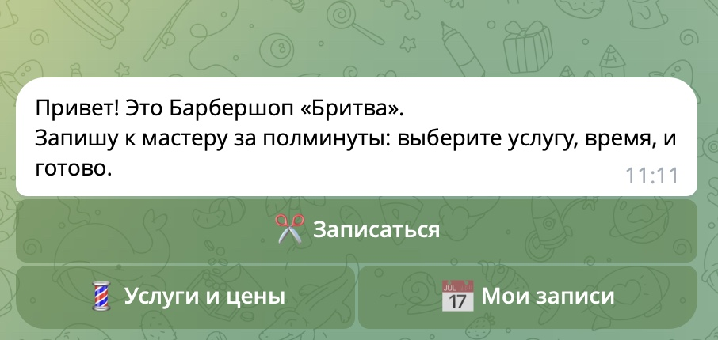
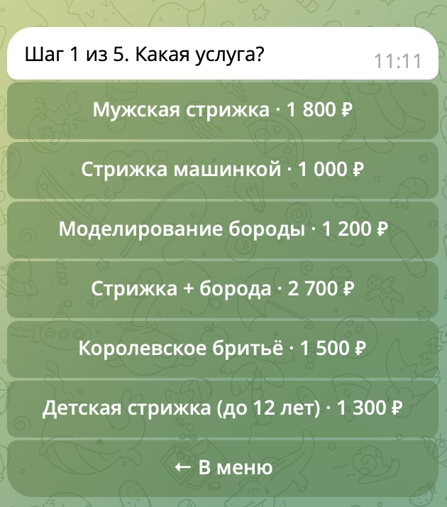
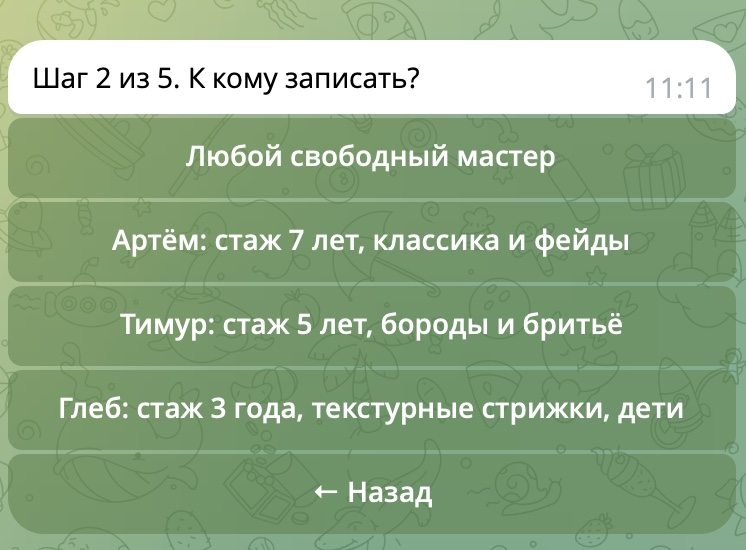
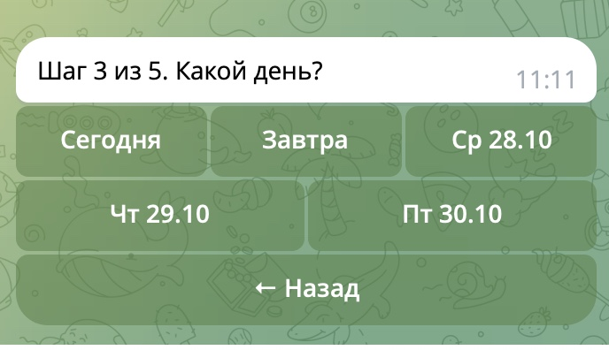
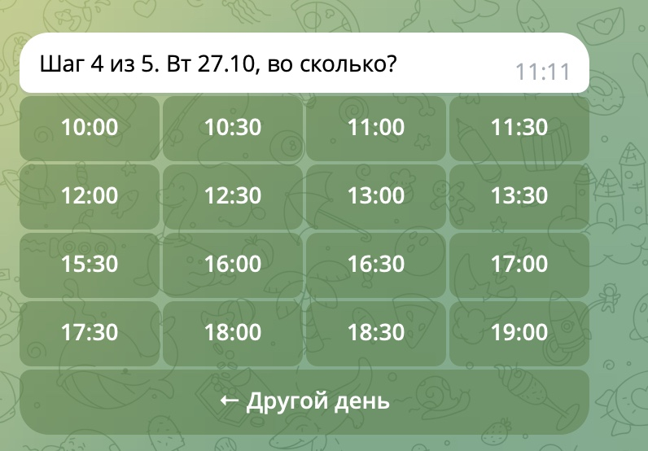
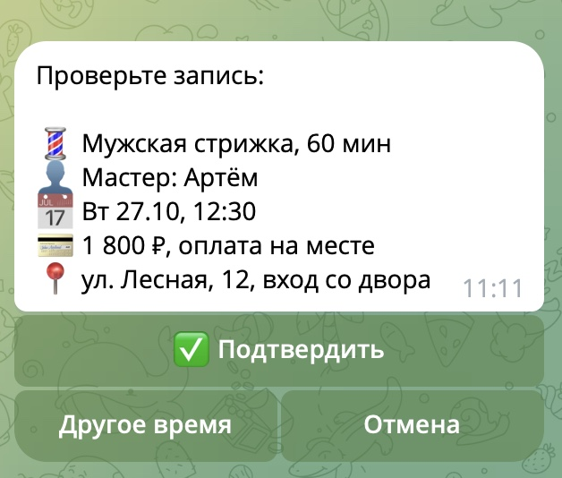
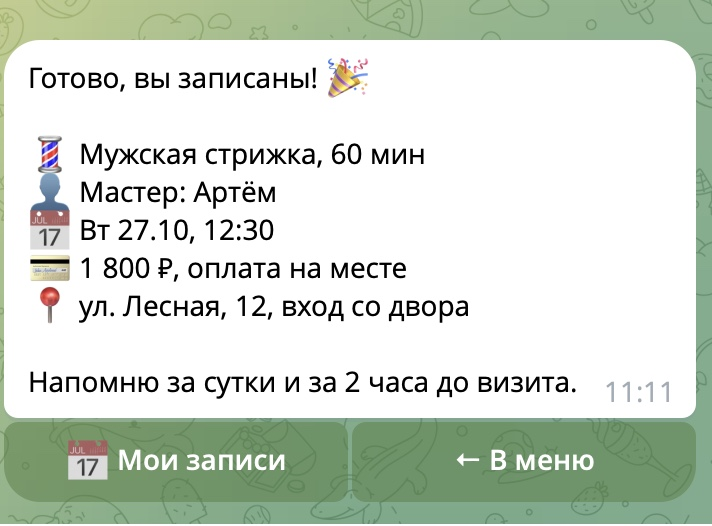

# Бот записи в барбершоп

Telegram-бот: услуги и цены, свободные слоты на неделю, запись к мастеру, напоминания за сутки и за 2 часа. Python, aiogram 3, SQLite.

Учебный кейс (бриф 4.2), барбершоп «Бритва», услуги, мастера и адрес условные.

## Путь клиента

1. `/start`: приветствие и меню (Записаться, Услуги и цены, Мои записи)
2. Услуга: кнопки с ценой
3. Мастер: любой свободный или конкретный
4. День: только дни, где есть свободное время, на 7 дней вперёд
5. Время: свободные слоты с учётом длительности услуги
6. Телефон: одна кнопка «Отправить мой номер» (повторному клиенту не показывается)
7. Подтверждение: сводка записи, «Подтвердить» или «Другое время»
8. Готово: запись в базе, мастерам уходит уведомление

Новому клиенту нужно 7 нажатий, повторному 5. Напоминание приходит с кнопками «Приду» и «Отменить».

## Запуск

```bash
python3 -m venv venv
./venv/bin/pip install -r requirements.txt
cp .env.example .env    # вставить BOT_TOKEN от @BotFather
./venv/bin/python bot.py
```

`ADMIN_CHAT_ID` в `.env` необязателен: если указать id чата мастеров, туда будут приходить новые записи и отмены.

## Где менять данные

- `data/services.json`: услуги, длительность в минутах, цена
- `data/masters.json`: мастера и рабочие часы по дням недели (0 = понедельник)
- `bot.py`, константы вверху: название, адрес, шаг сетки (30 мин), минимум за сколько минут можно записаться

## Проверка

`./venv/bin/python test_bot.py` проверяет без Telegram: свободные слоты, защиту от двойной записи, напоминания, отмену, разбор телефона.

## Скриншоты

| Меню | Услуга | Мастер | День |
|---|---|---|---|
|  |  |  |  |

| Время | Подтверждение | Готово |
|---|---|---|
|  |  |  |
